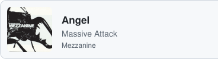

Third-year Informatics Engineering student at <a href="https://www.isep.ipp.pt/">ISEP</a>, Porto.
Each semester of the degree is built around an integrative project: a team project run with Scrum from start to finish, in which that semester's courses come together in a single system (see pinned repositories).

Most drawn to back end: services shaped around a clear domain model, carefully designed databases beneath them, and tests written before the code.
Over years in pharma and data work I've run user-acceptance testing on validated systems like Veeva Vault, labelled training data for ML models, and pushed for QA automation.
In those settings every change has to be traceable, and that taught me what regulated software asks of the people who build it.
That's the kind of software I want to build, in healthcare, finance, aviation and beyond.

In my spare time I explore multi-agent LLM behaviour and event-driven design for social-deduction games with AI players.
Also interested in web design and happy to cross into the front end when a project calls for it.
Away from code, I produce music in Ableton Live.

<h3>Languages</h3>

  &nbsp;
  &nbsp;
  &nbsp;
  &nbsp;
  &nbsp;
  &nbsp;
  &nbsp;
  
   also SQL and PL/SQL · RISC-V Assembly

<h3>Frameworks and data</h3>

  &nbsp;
  &nbsp;
  &nbsp;
  &nbsp;
  &nbsp;
  &nbsp;
  &nbsp;
  &nbsp;
  &nbsp;
  
   also JavaFX · Entity Framework Core · HTMX · ANTLR4 · Keycloak

<h3>Testing, build and tools</h3>

  &nbsp;
  &nbsp;
  &nbsp;
  &nbsp;
  &nbsp;
  &nbsp;
  &nbsp;
  
   also Maven · JaCoCo · xUnit · Testcontainers · PlantUML · QEMU

<h3>Projects</h3>

  <b><a href="https://github.com/cmmfernandes92/laprizza">LaPrizza</a></b> 🚧 Semester 5 · 2026/27 · team of 5 · sprint 1 of 3 
  A restaurant information system. An ASP.NET Core REST API with onion architecture and 21 ADRs, Keycloak (OIDC/JWT) role-based security, EF Core on PostgreSQL, 773 automated tests, and a one-command Docker Compose stack. 
  C# · TypeScript · .NET · PostgreSQL · Keycloak · Docker

  <b><a href="https://github.com/cmmfernandes92/aisafe">AISafe</a></b> Semester 4 · 2025/26 · team of 5 
  An air traffic control and flight simulation platform. A test-driven DDD core in Java (about 1,300 tests), a flight-plan DSL compiled with ANTLR4, TCP/UDP remote access, a concurrent airspace simulator in C, and a Spring Boot + HTMX web app with a 3D flight-plan simulator. 
  Java · C · ANTLR4 · Spring Boot · HTMX · JPA/Hibernate

  <b><a href="https://github.com/cmmfernandes92/logistics-on-rails">Logistics on Rails</a></b> 🏆 Semester 3 · 2025/26 · team of 5 · recognised among the best projects of the year 
  A railway logistics platform. A JavaFX desktop app over a 29-table Oracle schema with business rules in PL/SQL, graph and spatial algorithms on real data (64k European stations) on hand-built AVL trees, 2D-trees and graphs, and station modules in RISC-V Assembly. 
  Java · JavaFX · Oracle PL/SQL · C · RISC-V Assembly

  <b><a href="https://github.com/cmmfernandes92/empire-on-tracks">Empire on Tracks</a></b> Semester 2 · 2024/25 · team of 5 
  A railway-transport simulator. An object-oriented Java domain with two UIs (a 34-view JavaFX app and a console app), graph analysis of the network (transitive closure, Eulerian trails, shortest paths), and complexity and statistics studies in Python. 
  Java · JavaFX · Python · JUnit 5 · Jupyter

<h3>Outside of code</h3>

  <picture>
    <source media="(prefers-color-scheme: dark)" srcset="assets/ableton-dark.svg">
    
  </picture>&nbsp;
  <picture>
    <source media="(prefers-color-scheme: dark)" srcset="assets/max-dark.svg">
    
  </picture>&nbsp;
  <picture>
    <source media="(prefers-color-scheme: dark)" srcset="assets/juce-dark.svg">
    
  </picture>&nbsp;
  <picture>
    <source media="(prefers-color-scheme: dark)" srcset="assets/soundcloud-dark.svg">
    
  </picture>&nbsp;
  <picture>
    <source media="(prefers-color-scheme: dark)" srcset="assets/applemusic-dark.svg">
    
  </picture>
   music production · sound design

  🎧 <b>On repeat</b> 
  <a href="https://music.apple.com/album/come-down-to-us/1487389762?i=1487389770"><picture><source media="(prefers-color-scheme: dark)" srcset="assets/songs/come-down-to-us-dark.svg"></picture></a><a href="https://music.apple.com/album/come-down-to-us/1487389762?i=1487389770"><picture><source media="(prefers-color-scheme: dark)" srcset="assets/songs/come-down-to-us-apple-dark.svg"></picture></a><a href="https://open.spotify.com/track/24mRY501qetRyl5wtLVP87"><picture><source media="(prefers-color-scheme: dark)" srcset="assets/songs/come-down-to-us-spotify-dark.svg"></picture></a> 
  <a href="https://music.apple.com/album/the-beach/1700927794?i=1700927799"><picture><source media="(prefers-color-scheme: dark)" srcset="assets/songs/the-beach-dark.svg"></picture></a><a href="https://music.apple.com/album/the-beach/1700927794?i=1700927799"><picture><source media="(prefers-color-scheme: dark)" srcset="assets/songs/the-beach-apple-dark.svg"></picture></a><a href="https://open.spotify.com/track/74MrkICU9XLNrRzdycgFrM"><picture><source media="(prefers-color-scheme: dark)" srcset="assets/songs/the-beach-spotify-dark.svg"></picture></a> 
  <a href="https://music.apple.com/album/angel/724466069?i=724466660"><picture><source media="(prefers-color-scheme: dark)" srcset="assets/songs/angel-dark.svg"></picture></a><a href="https://music.apple.com/album/angel/724466069?i=724466660"><picture><source media="(prefers-color-scheme: dark)" srcset="assets/songs/angel-apple-dark.svg"></picture></a><a href="https://open.spotify.com/track/7uv632EkfwYhXoqf8rhYrg"><picture><source media="(prefers-color-scheme: dark)" srcset="assets/songs/angel-spotify-dark.svg"></picture></a>

